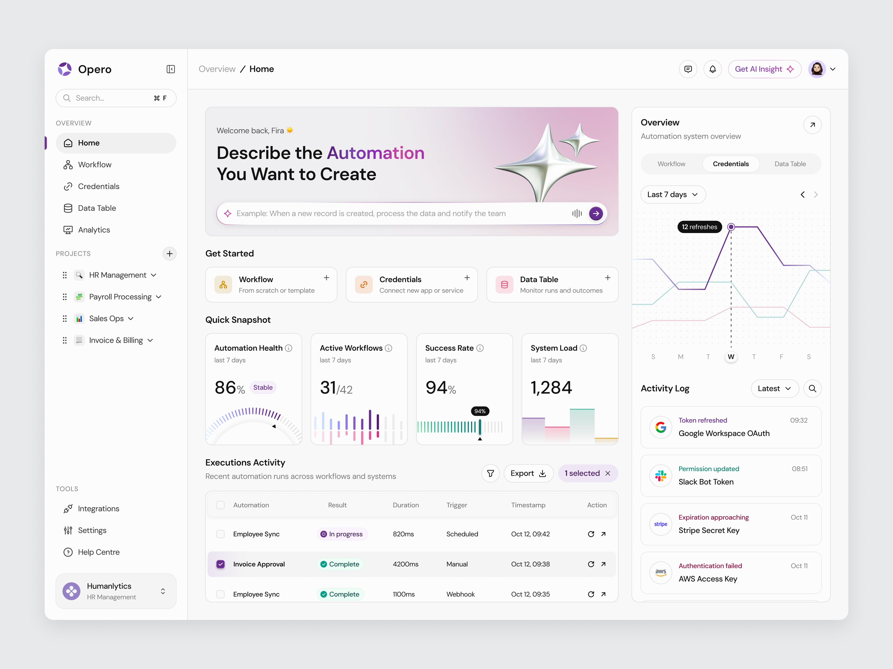

# Creavate

**Create more. Coordinate less.**

Connect platforms. Collaborate with AI. Focus on creating.

Creavate is being built to coordinate a creator's brand-deal workflow across Gmail, Slack, Google Drive and Google Calendar. Three specialized agents communicate through [Switch](https://github.com/sandbox-quantum/switch), while the creator stays in control of campaign execution.

> **Development status:** Phase 0 — Switch discovery is in progress. This repository contains sourced integration research, a disposable protocol probe, setup tooling and the dashboard design reference. The live Switch/Slack gate has not passed. The full application, Google integrations and dashboard are planned.

**Selected direction:** Slack for chat and three OpenCode agents, each with its own Switch identity. Credentials/live setup is user-deferred. OpenCode/Core version compatibility and per-role tool restrictions still need a real-service gate; see [runtime findings](SWITCH_INTEGRATION.md#14-opencode-and-claude-code-runtime-setup).

## The workflow

The first release is designed around one complete sponsorship workflow:

1. A sponsorship inquiry arrives in the creator's Gmail inbox.
2. Brand Agent reads the inquiry and brief, extracts the deal terms, flags risks and assesses fit.
3. Talent Manager presents the analysis and the exact proposed actions to the creator in Slack.
4. The creator approves or rejects the request.
5. After approval, Campaign Agent organizes the campaign in Drive, creates Calendar deadlines and records the task list.
6. Talent Manager reports results backed by actual tool responses and persisted activity.

Instagram and YouTube are outside the scope of v1.

### Agent responsibilities

| Agent | Responsibility | Tool boundary |
| --- | --- | --- |
| Brand Agent | Analyze inquiries, briefs, deliverables, fees, rights and risks | Read-only Gmail and Drive access |
| Talent Manager | Coordinate handoffs, request approval and report results | Approval requests/checks and Switch room messaging |
| Campaign Agent | Create the approved campaign assets, deadlines and tasks | Write tools that verify a recorded approval ID before acting |

These product agents are planned. The current Phase 0 probe is a separate, deliberately limited protocol client.

## What is available today

| Component | Purpose |
| --- | --- |
| [Switch integration findings](SWITCH_INTEGRATION.md) | Verified protocol details, pinned sources, documentation differences and unresolved questions |
| [Phase 0 runbook](docs/phase0/RUNBOOK.md) | Local Switch setup, Slack connection and the real-service probe procedure |
| [Recorded observations](docs/phase0/OBSERVATIONS.md) | What was actually checked and which live checks remain open |
| [Protocol probe](spikes/switch-mention/spike.mjs) | Register one custom identity, receive a mention over SSE, read real room history and post one history-derived reply |
| [Probe unit checks](spikes/switch-mention/spike.test.mjs) | Approval guards, scope/expiry checks, replay prevention, SSE parsing and untrusted-text handling |
| [Switch preparation script](scripts/phase0/prepare-switch.py) | Generate private configuration using the pinned upstream secret generator |
| [Task list](TASKS.md) | Phase gates and outstanding work |
| [Decisions](DECISIONS.md) | Accepted requirements, proposals and open decisions |

The probe requires an operator-recorded approval before registration, connection claiming or replying. Its disposable local SQLite ledger is separate from the planned Supabase approval system. Test fixtures are isolated to the automated test file.

## Get started with Phase 0

### Prerequisites

- Git.
- Node.js with built-in `node:sqlite` support. The discovery checkpoint was checked with Node.js 26.13.0.
- Python 3 and OpenSSL for preparing the upstream configuration.
- Docker Engine with Docker Compose, accessible to your account, for the live Switch stack.
- A Slack workspace where you can install an app and use a dedicated test channel.

### Clone and run the local checks

```sh
git clone https://github.com/vishal88736/creavate.git
cd creavate
node spikes/switch-mention/spike.test.mjs
node --check spikes/switch-mention/spike.mjs
git diff --check
```

The Phase 0 probe uses Node built-ins and requires no npm package installation. Its 12 named unit checks passed at the discovery checkpoint. They validate local code; they do not establish a live Switch or Slack connection.

### Run against real Switch and Slack

Follow the [Phase 0 runbook](docs/phase0/RUNBOOK.md) in order. It covers:

1. Cloning the exact reviewed Switch revision.
2. Preparing private configuration and validating the official Compose files.
3. Starting the stack and checking actual health/readiness.
4. Installing a Slack app, connecting the workspace and linking the creator's identity.
5. Recording scoped operator approvals and registering the probe.
6. Receiving a real Slack mention, recording SSE delivery, posting the actual history-derived result and reading it back.
7. Independently confirming that the reply appeared in Slack.

The prepared local configuration uses these loopback addresses:

| Service | Address |
| --- | --- |
| Switch API | `http://127.0.0.1:18000` |
| Switch Gateway | `http://127.0.0.1:13000` |
| Switch PostgreSQL | `127.0.0.1:15432` |

These are configured addresses, not a claim that the services are running. Check port availability before startup. The recorded Compose configuration validation passed; the live mention/reply gate remains open.

### Configuration and secrets

Use [.env.example](.env.example) as the template for an ignored `.env.phase0` file. Keep private environment files at mode `0600`.

- `.env.phase0`: local Switch inputs and optional Slack credential staging.
- `.env.phase0-agent`: the agent credentials returned by real registration.
- `.local/upstream-switch/.env`: generated upstream Switch configuration.
- `.local/phase0/probe.sqlite`: private probe approvals, write receipts and observations.

These paths are ignored by Git. Never commit credentials or raw room/email evidence. Google credentials are not needed for Phase 0; encrypted Google token storage belongs to the later application implementation.

## Planned application architecture

| Layer | Planned technology |
| --- | --- |
| Dashboard | React, TypeScript, Vite, Tailwind CSS and shadcn/ui |
| Backend | Node.js, TypeScript and Express |
| Database and authentication | Supabase PostgreSQL, Supabase Auth and migrations in the repository |
| Agent communication | Switch behind one application adapter |
| Agent runtime | OpenCode sessions through the documented Switch host; provider/model in configuration; live validation pending |
| Creator tools | Gmail API, Google Drive API, Google Calendar API and Slack through Switch |

The planned npm-workspace layout is:

```text
apps/
  web/                   Dashboard
  server/                API, ingestion, webhooks and agent host
packages/
  shared/                Types and Zod schemas
  switch-adapter/        Switch protocol boundary
  agents/                Instructions/config for three OpenCode identities
  google-mcp/            Role-scoped Google tools and approval guards
supabase/
  migrations/            Application schema and access policies
```

These workspaces will be created in the later phases. The current executable code is isolated under `spikes/` and `scripts/phase0/`.

### Product requirements

- Every write tool must verify an approval from the creator's authenticated identity, mapped from the chat user ID, and the exact deal/action in the database. Agents and other room members cannot approve.
- Email and attachment content is untrusted data and cannot alter instructions, tools, identities or permissions.
- Agent handoffs go through Switch and must respect authenticated identities and a persisted hop cap.
- Tool calls, workflow transitions and activity must be recorded. Reported results must come from actual returns.
- Stored Google tokens must be encrypted.
- Mocked unit tests and live-service tests must remain separate.
- Each phase must pass its live gate and receive the required review before the next phase starts.

These are implementation requirements for v1; the Phase 0 probe does not establish that the full product already satisfies them.

## Roadmap and gates

| Phase | Scope | Required gate |
| --- | --- | --- |
| 0 — In progress | Switch discovery, custom SSE probe and OpenCode route | Real Slack round-trips, actual tool results and verified runtime/tool restrictions |
| 1 — Planned | Monorepo, tooling, schema and CI | CI green and migrations applied to a fresh Supabase project |
| 2 — Planned | Switch adapter and three identities | Agent presence in Slack and a real two-agent round-trip |
| 3 — Planned | Google OAuth, encryption and role-scoped MCP tools | Actual test-account tool calls with database records |
| 4 — Planned | Multi-agent coordination | Real inquiry analysis delivered through Switch |
| 5 — Planned | Creator-only approval and execution | Wrong identities/rejection have no write effect; approved artifacts are read back from Google |
| 6 — Planned | Dashboard and live activity | Feed updates during a real run without hardcoded entries |
| 7 — Planned | End-to-end validation | Two clean-state real-account runs and prompt-injection isolation |

See [TASKS.md](TASKS.md) for the detailed checklist. Completing repository maintenance or merging a branch does not pass a product phase gate.

## Dashboard direction

The supplied image guides the planned Phase 6 dashboard: pale surfaces, purple accents, a left sidebar, central overview and execution table, and a right activity rail. Creavate will use real application records for its metrics, approvals and activity.

**Design reference — this is not a screenshot of an implemented Creavate dashboard:**



## Repository workflow

All project work is maintained on `main`. Keep changes focused, record decisions and phase evidence, and commit verified milestones. Additional branches are created only if explicitly requested.

## Licensing and upstream software

A license for Creavate has not yet been selected.

Switch is external software with its own [Apache 2.0 plus modified Commons Clause terms](https://github.com/sandbox-quantum/switch/blob/0d2a57ce643a57a56cd955f6a80324327558f0dd/LICENSE). Its commercial deployment model remains an open decision in [DECISIONS.md](DECISIONS.md). The upstream checkout and generated runtime data are kept outside the tracked project files.
